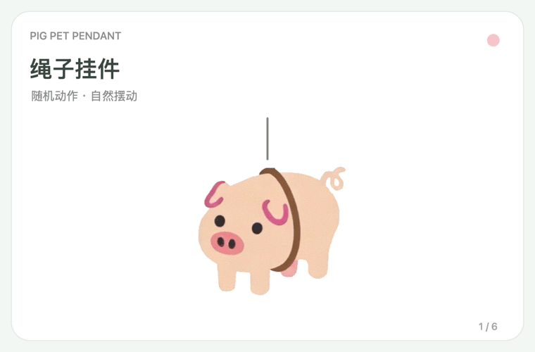

> 说明：本 README 不是人工撰写，而是由 AI 生成。

# Pig Pet Pendant（猪猪鼠标挂件）

一款跟随鼠标移动的桌面小猪挂件。提供 macOS 客户端，并新增 Windows 原生客户端源码。



*预览依次展示六种模式，由应用自动渲染画面合成，非实机录屏。*

## 模式

- **绳子挂件**：默认模式，小猪随鼠标摆动。
- **猪猪气球**：显示 1–8 只向上漂浮的猪气球，默认 2 只。
- **网兜小猪**：带循环动画的小猪网兜。
- **竹子小猪**：小猪抱着随鼠标动作弯垂的竹子。
- **猪上吊**：小猪通过绳子悬挂；主体保持清晰，光环采用与幽灵猪一致的柔和闭合效果。
- **幽灵猪**：不带绳子，平滑跟随鼠标。

## 使用

macOS 点击菜单栏图标，Windows 点击系统托盘图标，在菜单中切换模式或打开“设置”。设置会自动保存；关闭设置窗口不会退出挂件。选择“退出猪猪挂件”才会结束应用。

## 构建

需要 macOS 12 或更新版本及 Xcode Command Line Tools。在仓库根目录运行：

```bash
./build.sh
open dist/PigPendant.app
```

构建产物和对应架构的 ZIP 包生成在 `dist/`。应用使用本地临时签名，未经过 Apple 公证；首次在其他 Mac 打开时，系统可能显示安全提示。

可运行构建、物理与 GUI 冒烟检查：

```bash
./build.sh --test
```

GUI 检查需要已登录的桌面会话，会短暂显示测试挂件后自动退出。

### Windows

需要 Windows 上的 .NET 10 SDK；工程使用 WPF。在仓库根目录运行：

```powershell
powershell -ExecutionPolicy Bypass -File .\windows\scripts\build.ps1 -Test
& .\windows\src\PigPendant.Windows\bin\Release\net10.0-windows\PigPendant.Windows.exe
```

托盘菜单可切换六种模式、显示/隐藏、重置姿态、打开设置和退出。设置保存在 `%LOCALAPPDATA%\PigPendant\settings.json`。再次启动会通知已运行实例打开设置。

单文件自包含发布使用：

```powershell
powershell -ExecutionPolicy Bypass -File .\windows\scripts\build.ps1 -Test -Publish
```

发布结果为 `dist/PigPendant-Windows-win-x64.exe`，约 79 MB；素材、.NET 运行时与应用代码都打包在这一个文件中，用户双击即可运行，不需要安装 .NET SDK。首次启动时 .NET 会把必要的原生组件解包到用户临时目录；设置仍保存在 `%LOCALAPPDATA%\PigPendant\settings.json`。当前只发布 Windows x64，未做代码签名。

## 已知限制

- Windows 版的多屏混合 DPI、真实跨进程点击穿透、焦点、睡眠恢复、Explorer 重启以及长期性能尚待实机验收。
- 气球之间没有碰撞检测，也没有屏幕边界限制。
- 应用不申请辅助功能或屏幕录制权限，不向网络发送请求。

## 许可

仓库尚未提供通用开源许可证。公开可见不代表允许复制、修改、再分发或商用源码与素材；如需使用，请先取得相应许可。

## 相关文档

- [Windows 移植计划](docs/WINDOWS_PORT_PLAN.md)
