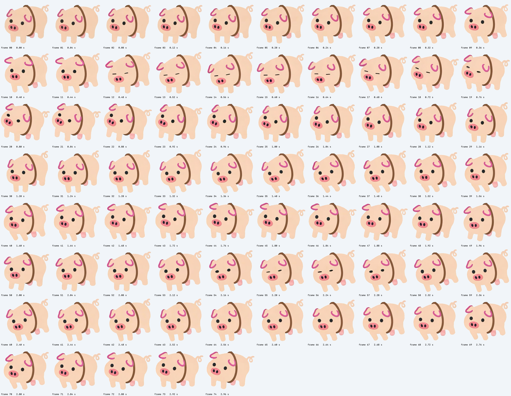

# 绳子小猪：动作素材、姿态分析与播放策略

## 可复用产物

| 产物 | 用途 |
| --- | --- |
| [完整姿态索引图](media/rope-animation-poses.png) | 查看全部 75 帧及原始时间，讨论动作时直接引用帧号 |
| [姿态与接缝分析 JSON](media/rope-animation-analysis.json) | 保存素材 SHA-256、帧时长、相邻差异及各帧最相近的五个非邻近姿态 |
| [状态驱动实绘预览](media/rope-state-preview.gif) | 展示静止、移动、下坠、停止的自动绘制序列，便于复看效果 |
| [分析脚本](../tools/analyze-rope-animation.swift) | 只用 macOS 原生框架重新生成索引图和分析结果 |
| [透明原始动作素材](../PigPendant/Resources/rope-pig.png) | 保留用户 GIF 的 75 帧、每帧 40 毫秒，不重绘角色 |
| [素材提取脚本](../tools/extract-rope-pig.swift) | 从用户原 GIF 去除上方长绳及远离角色的游离点，对齐共同悬挂接点 |
| [动作调度器](../PigPendant/Core/RopeCharacterAnimation.swift) | 定义动作片段、随机待机、运动响应及帧间混合 |



索引图与分析数据是从透明素材生成的中间产物。状态预览来自实际 AppKit 绘制路径与合成锚点输入，约第 4 秒移动、第 7 秒下坠，不是实机录屏；预览 GIF 自身循环仅为方便查看，不代表应用固定循环播放动作。临时截图、测试日志、偏好备份和调试包留在忽略目录 `dist/`，不进入这些长期资料。

## 为什么原循环会跳

分析脚本把每帧转换为 sRGB 预乘 Alpha 的 RGBA，缩小到 99×89，计算所有通道的平均绝对字节差。分数越小，整体轮廓和颜色越相近；范围为 0–255。

| 帧对 | 差异分数 |
| --- | ---: |
| 原循环接缝 `74 → 0` | 42.867 |
| 正常相邻帧平均 | 10.943 |
| 正常相邻帧最大值 | 27.416 |
| 拱身动作入口 `0 → 28` | 10.284 |
| 眨眼动作收尾 `28 → 0` | 10.284 |
| 曾考虑的拱身直接收尾 `51 → 0`（不采用） | 12.364 |

因此不再使用 `74 → 0` 作为播放接缝，而是从相近姿态进入、退出短动作。虽然 `51 → 0` 的全图差异也较低，实绘中混合仍会使五官短暂错位；最终不采用这个直接出口，而是沿原相邻帧 `50…28` 回收姿态，再由 `28 → 0` 收尾。这也说明全图分数不能单独替代局部五官检查。

上述数值来自脚本实际输出，不是主观流畅度评分；它不识别动作语义，也不是光流或骨骼分析。“眨眼、动耳朵、拱身”等名称是依据原帧人工观察后的分类。整体朝向对齐也曾作比较，但最终采用原相邻姿态回收，不额外旋转或缩放角色来修补接缝。

## 当前动作划分

帧号从 0 开始；所有像素仍来自原素材。这里只改变播放调度，不改写资源里的帧序、尺寸或时长。

| 动作 | 原帧路径 | 触发 |
| --- | --- | --- |
| 眨眼 | `0…28` | 随机待机动作；包含原动画自然的耳朵和身体变化 |
| 动耳朵 | `0…11 → 10…0` | 随机待机动作；反向回放相邻原帧完成收尾 |
| 轻拱身 | `28…51 → 50…28` | 随机待机动作；包含四肢及身体变化，沿相邻姿态回收 |
| 移动反应 | `0…11 → 10…0` | 鼠标或绳端明显移动，播放速度随运动强度变化 |
| 下坠反应 | `28…51 → 50…28` | 实际绳端向下运动，播放速度随下坠速度变化 |

这些不是重新生成的独立表情图，而是对原动画片段的复用。可从索引图继续调整片段边界，不需要再做一次抠图。

## 调度与过渡

- 待机停在第 0 帧。首次等待约 1.2–2.5 秒，之后每次动作结束随机等待约 2–5 秒；连续两次待机动作不选同一种。
- 鼠标速度和绳端速度都参与运动检测；下坠判断使用 AppKit 坐标系中向下的实际绳端速度，不只检查鼠标是否移动。
- 速度做平滑和滞回，避免微小抖动不断重启动作。运动触发优先于待机；当前动作自然收尾后再接下一次反应，不在中途硬换脸。
- 拱身入口用约 0.14 秒从第 0 帧混合到第 28 帧；非待机姿态的出口用约 0.18 秒回到第 0 帧。入口和出口用 smoothstep 缓入缓出，运动动作可随速度适度加快。
- 片段内部也对相邻原帧插值。绘制在透明图层中按预乘 Alpha 权重相加，而不是把两张半透明图片依次盖上去，避免躯干变淡、绳子透出来。
- 动作播放时约 60 Hz 更新，物理已静止且等待动作时回到 15 Hz。角色动画不重新激活已经休眠的绳子物理。
- 隐藏或系统睡眠时冻结动作时钟和随机等待，恢复后继续；切换模式才重新进入待机。其他模式保持原有播放和休眠方式。

## 重新生成与验证

在 macOS、已安装 Xcode Command Line Tools 的环境执行：

```bash
swift -O tools/analyze-rope-animation.swift \
  PigPendant/Resources/rope-pig.png docs/media

./build.sh --test

# 可选：把本次 GUI 冒烟的 14 秒实绘序列也保存为 GIF。
swift -O tools/analyze-rope-animation.swift \
  PigPendant/Resources/rope-pig.png docs/media dist
```

分析脚本输出包含素材摘要，可判断报告是否对应当前资源；相同输入和系统图像处理实现会生成相同的数值。不同系统版本的缩放实现可能使末位数值略有不同。

自动测试覆盖随机待机间隔与动作选择、移动/下坠区别、过渡权重连续性、不同输入帧率、物理休眠、透明帧混合、共同绳端接点及隐藏/睡眠恢复。GUI 冒烟还会把“静止 → 移动 → 下坠 → 停止”的实绘序列写入 `dist/rope-state-*.png`。主观自然度仍需实际使用确认，不能只用差异分数或编译通过代替。
