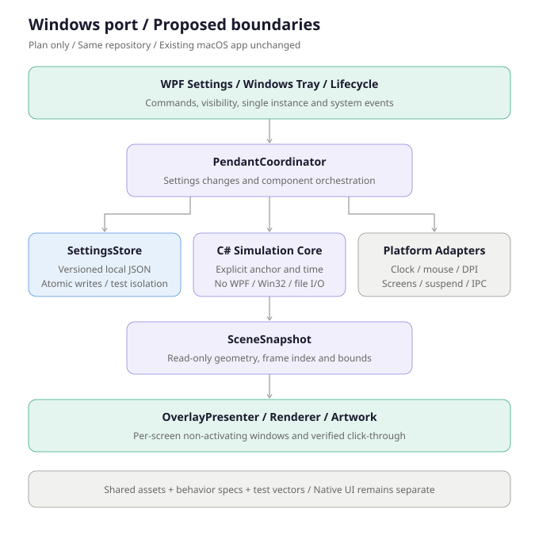

# Windows 移植方案与接力指南

## 1. 交付状态与边界

状态更新（2026-10-25）：已新增 `windows/` 下的 .NET 10/WPF 工程、构建脚本、核心检查、六模式绘制、APNG 解码、动态托盘与设置。全局 .NET 10.0.402 SDK 安装、构建、核心与素材检查、自包含单 EXE 发布及独立启动检查已在 Windows 本机通过；原方案以下各阶段中仍有未完成的交互桌面验收。当前发布命令及产物以 README 的 Windows 章节为准；下文保留最初移植方案，部分路径与发布形式已过时。

编写日期：2026-10-25。代码阅读基线为 `ee729be`，当前产品已是六种模式，不是早期四模式版本。编写时工作区还存在其他任务的未提交修改；它们不随本方案提交。开始移植时必须重新读取最新源码、README 和项目约束，不能把本方案当作冻结的实现规范。

目标：在同一仓库增加原生 Windows 客户端，不重写、不破坏已有 Swift/AppKit 应用。先支持 Windows 11 x64 的本地交互桌面；ARM64、旧版 Windows、远程桌面和独占全屏兼容性另行验收，不预先承诺。

## 2. 已确定的管理方式

- 继续使用同一仓库及 `main`，Windows 开发使用短期功能分支，不 fork，不维护永久的平台分支。
- 初期保留 `PigPendant/`、`Package.swift`、`build.sh` 的现有位置和作用，避免同时迁移 macOS 目录。
- Windows 实现在 `windows/`；未来确有需要时，再单独迁移成 `apps/macos` 和 `apps/windows`。
- 初期共用现有原始素材和行为规范，C# 与 Swift 分别实现模拟算法，以公共输入轨迹和误差阈值验证一致性。不为了复用而先引入 C++、Rust 或跨语言桥接。
- Windows 阶段增加按目录生效的平台协作约束，明确根规则中哪些是 macOS 专属；保留原图、单实例、无后台服务和不得宣称未验证结果等共同约束。

以下是移植前的拟议目录；已落地的实际结构见 `windows/`：

```text
PigPendant/                          # 现有 macOS 客户端，路径不变
  Resources/                         # 第一阶段素材的唯一来源
Tests/                               # 现有 Swift 检查，保持不变
docs/
  WINDOWS_PORT_PLAN.md
  windows-port-architecture.svg
shared/
  test-vectors/                      # 后续生成：时间、锚点、参数、期望结果
windows/
  PigPendant.slnx
  global.json                        # 锁定实施时实际安装和验证的 SDK
  src/
    PigPendant.Core/                 # net10.0，无 WPF/Win32/文件 I/O
    PigPendant.Windows/              # net10.0-windows，WPF/Win32 适配
  tests/
    PigPendant.Core.Tests/           # MSTest，使用正常测试运行器
    PigPendant.Windows.Smoke/        # 单独的桌面验证程序
  scripts/
    build.ps1                        # 构建、检查、发布和资源校验
    smoke.ps1                        # 桌面验证及外部清理
dist/                                # 生成物，继续忽略
```

素材先由 Windows 项目从 `PigPendant/Resources/` 链接并嵌入，不能运行时访问源码目录或 macOS 的 `.app`。待两个客户端稳定后，再迁移到公共素材目录；迁移必须同步修改两个平台的打包及一致性检查，不复制成两套人工维护的源素材。

## 3. 技术选型与职责

推荐 C#、.NET 10 LTS、WPF，以及局限在平台层的 Win32 调用。.NET 10 的官方支持期限至 2028-11-14；移植时再次确认 SDK、操作系统和支持周期。开发需要 SDK，自包含发布的用户不需要预先安装 .NET。无需先安装完整 Visual Studio，可使用 SDK、VS Code 和 PowerShell。



| 组件 | 职责 | 当前 macOS 参考 |
| --- | --- | --- |
| `PendantCoordinator` | 连接组件、处理命令、同步设置和托盘 | `PigPendant/App/PendantCoordinator.swift` |
| `PendantSimulation` | 锚点与时间输入、六模式状态推进、收敛 | `PigPendant/Core/PendantSimulation.swift` |
| `RopePhysics` / `BambooPose` | 固定步长物理、竹子姿态与接触几何 | `PigPendant/Core/` |
| `SceneSnapshot` | 不含窗口和可变物理对象的只读帧 | `PigPendant/Presentation/SceneSnapshot.swift` |
| `OverlayPresenter` / renderer | 每屏窗口、脏区域、曲线与素材绘制 | `PigPendant/Presentation/` |
| `UpdateDriver` | 单调时钟、鼠标采样、活动/空闲与暂停调度 | `PigPendant/Platform/UpdateDriver.swift` |
| `SettingsStore` | 校验、版本化配置、本地原子保存 | `PigPendant/Settings/` |
| 托盘和设置窗口 | 显示/隐藏、模式及参数切换、重置、退出 | `PigPendant/UI/` |

不要直接复制 Apple 类型。`CoreGraphics`、`NSPoint`、`CGFloat`、AppKit 和 UserDefaults 不是 Windows 核心依赖；C# 核心使用自己的 `double` 向量、参数及快照类型。跨平台误差以明确阈值比较，不要求浮点逐位一致。

## 4. 先解决的平台风险

### 4.1 透明、点击穿透及不抢焦点

第一阶段只绘制一个静态挂件，验证 WPF 无边框透明窗口、隐藏任务栏入口和非激活显示，再接入全功能。

- 在独立 Win32 适配层处理扩展窗口样式、非激活显示、命中测试和显示器消息；不让业务逻辑到处调用 P/Invoke。
- `IsHitTestVisible=false` 只能处理 WPF 内部命中测试，不能证明点击已传给其他应用；`WS_EX_TRANSPARENT` 等样式也必须结合真实底层窗口测试，不能仅检查标志位。
- 设置窗口可主动激活；挂件窗口不能夺取键盘焦点。输入采样不修改系统鼠标，不注入点击，不安装全局鼠标钩子或申请管理员权限。
- 如果 WPF 透明窗口不能满足跨进程穿透或性能要求，只替换显示适配层为原生 layered HWND / `UpdateLayeredWindow`，保留核心、配置及设置 UI；先记录失败证据，不并行维护两套渲染实现。
- 不承诺覆盖 UAC 安全桌面、锁屏或独占全屏；解锁、返回普通桌面后必须正确恢复。

### 4.2 坐标、DPI 和多屏

- 进程采用 Per-Monitor V2 DPI awareness，处理屏幕热插拔、缩放变化和负虚拟桌面坐标。
- 明确三种坐标：Win32 全局物理像素、核心模拟单位、每屏 WPF 局部 DIP。禁止直接混用 `GetCursorPos` 的像素与 WPF 的 DIP。
- 初期可将核心空间定义为虚拟桌面物理像素、Y 向上；用户长度/尺寸仍按 96-DPI 逻辑单位保存，在适配层按锚点屏幕 DPI 换算。渲染时使用各目标屏幕自己的变换，不能假设所有屏幕缩放相同。
- 变换定义、锚点跨 DPI 时的参数及节点重标定必须写成可测函数；保持已有位置与速度的连续性，不能靠每次跨屏重置姿态掩盖跳变。跨 DPI 的视觉大小取舍须在第一阶段实机确认，再固定规则。
- 用同一快照绘制各屏部分，覆盖新旧包围区域；竹叶、光环及旋转角色都计入边界，不用大幅裁切截图掩盖错误。

### 4.3 动画解码与托盘

- `net-pig.png` 实际是 APNG，不能按普通 PNG 只显示第一帧。保留 62 帧、207 × 200 画布、每帧 40 ms、总时长 2.48 s。
- 先验证解码器对动画格式、透明、帧合成和 disposal 的实际支持，不假设 WPF 原生图片控件能直接播放全部素材。
- 若标准库不能解码 APNG，优先在开发阶段将源动画无损导出为 PNG 帧与时序清单，保留源哈希、完整画布、帧序和时长；派生物必须可重复生成和逐帧校验，不能手工维护第二份动画。确需第三方解码库时，再确认许可证、依赖版本和打包影响。
- Windows 托盘可使用 .NET 自带 `NotifyIcon` 加少量 Win32 适配，不必引入完整 UI 框架。GIF 帧、旋转及缩放由应用驱动生成静态图标帧，不假设系统托盘直接播放 GIF；销毁旧图标句柄，验证长期运行无 GDI 资源泄漏。
- 托盘图标大小和合成规则以 Windows 实机为准，不照搬 macOS 的点数；Explorer 重启后重新注册图标。

### 4.4 生命周期、单实例与配置

- 每个用户会话仅一个实例；建议命名互斥体配合本地命名管道，第二次打开只通知原实例显示设置。明确本地 IPC 的用户边界和错误处理。
- 隐藏/系统睡眠时暂停挂件模拟和动画；恢复重设计时基准，不追赶暂停期间的时间。使用单调时钟，不用系统日期推进物理。
- 设置保存到 `%LOCALAPPDATA%\PigPendant\settings.json`，带 `schemaVersion`，使用临时文件加替换保证原子写入。保持 `DisplayMode` 的字符串标识及既有参数键语义，不自动读取或修改 macOS 偏好。
- 无效值必须记录原因并按规范恢复；磁盘写入失败应通知用户，不能假装保存成功。
- 默认不联网、不自启动、不装服务、不请求管理员权限。设置窗口关闭不退出，托盘“退出”才结束进程。

## 5. 功能对齐范围

| 模式标识 | 素材 | 必须保留的行为 |
| --- | --- | --- |
| `rope` | `pig.png` | 默认、向下悬挂、单向可松弛约束 |
| `balloon` | `balloon.png` | 1–8 只、默认 2、共用锚点、向上浮、全部收敛才空闲 |
| `net` | `net-pig.png` | 向下悬挂、绳子静止仍播放、隐藏和睡眠停播 |
| `bamboo` | `bamboo-pig.png` | 连续竹身、稳定弧长、平滑弯垂、沿竹身滑动和贴抱、不拉伸角色 |
| `hanging` | `hanging-pig.png` | 沿用绳子物理，独立透明素材及光环 |
| `ghost` | `ghost-pig.png` | 无绳、鼠标右上方平滑跟随、收敛后降频、完整光环 |

共用参数：长度 20–1200、默认 140；尺寸 16–256、默认 48；重量感 0–200、默认 65；弹性 0–200、默认 55；衰减 0.2–8、默认 `-60 * log(0.985)`；重力/浮力 100–10000、默认 1350。竹子位置 0–100%，默认 50%。以最新 `ParameterID`、`BambooPigPosition` 及模式实现复核单位和内部比例。

气球数量只在气球模式显示，竹子位置只在竹子模式显示，隐藏整行而非置灰；切换不丢失保存值。幽灵模式保留共用物理设置但不用于无绳跟随。恢复默认回到原绳子模式，不覆盖素材或用户无关配置。

原图 `pig.png` 的 SHA-256 必须为 `38973788538d53eebce385d48e90e01cc9b65c0e20c3c2909d2de2688a423afe`。其余素材在实施开始时记录最新已提交版本的哈希，不把本机未提交图片当作跨电脑可取得的基线。

## 6. 实施顺序与每阶段验收

1. **冻结移植基线。** 读取最新规则和源码，记录起始 commit、素材哈希及现有测试。为 Windows 补充目录约束，创建 SDK 锁定文件、解决方案和两个目标工程；暂不搬 macOS 源码。
2. **平台可行性。** 静态透明挂件、真实穿透、不抢焦点、托盘入口、单实例及 100%/150%/200% DPI。通过后再实现模拟；失败时先更换显示适配方案。
3. **移植核心。** 依次移植向量、Verlet/XPBD、时间线、竹子姿态、模式推进及幽灵跟随。移植现有回归断言，再生成公共轨迹文件；Swift 导出的基线应在 Mac 上生成并记录版本，不能在 Windows 上凭空标为已对照。
4. **接入功能。** 用场景快照完成六模式、动画、设置保存、菜单同步、暂停/恢复；保留最新的长度调节及长帧间隔连续过渡，不恢复旧版重置/跳切问题。
5. **交付验证。** 正式版排除冒烟代码，发布自包含单文件 EXE，在另一目录双击运行，确认不依赖 SDK、源码目录或用户下载路径。

每阶段独立提交；失败就停留在本阶段，不用“能编译”替代 GUI 或手感验收。Windows 实施不能顺便更改 macOS 算法或外观。

## 7. Windows 机器上的接力步骤

### 现在可以做的事情

把包含本方案的提交通过自己选择的方式带到 Windows（自行 push 后 clone/pull，或使用 Git bundle）。本次不会自动 push；未提交的源码和素材不会自动随 Git 转移。

安装 Git 和 .NET 10 SDK，然后在 PowerShell 中：

```powershell
git status --short
git log -5 --oneline
dotnet --info
Get-Content .\docs\WINDOWS_PORT_PLAN.md -Encoding UTF8
git switch -c feature/windows-port
```

存在本地修改时先识别来源，不覆盖、不执行硬重置。把下面这段交给 Windows 上的开发助手：

> 请按 docs/WINDOWS_PORT_PLAN.md，从阶段 1 开始实施 Windows 原生版本。先读取最新 AGENTS.md、README.md、源码和提交状态；保留 macOS 工程及用户改动。采用 C#/.NET 10、WPF 与独立 Win32 适配，先验证透明、跨进程点击穿透、非激活、多屏 DPI、托盘和单实例，再移植六模式及现有回归。配置和 GUI 测试使用独立临时目录，外部脚本负责异常退出清理。分阶段构建、测试并提交；不把未经实机验证的功能写成通过。若当前实现已偏离方案，先核对差异，不盲目覆盖。

### 已实现的 Windows 构建命令

在仓库根目录执行：

```powershell
powershell -ExecutionPolicy Bypass -File .\windows\scripts\build.ps1 -Test -Publish
```

当前发布为 `dist/PigPendant-Windows-win-x64.exe`，自包含约 79 MB，所有素材内嵌；首次启动会把必要的原生组件解包到用户临时目录。未启用 trimming 或 Native AOT。

## 8. Windows 验收清单

- 核心：固定 120 Hz；30/60/120/144 Hz 输入；长帧、快速转向、负坐标、大位移；松弛不推挤、最多 12% 伸长；极值、收敛、轴向重量响应及连续调长度。
- 六模式：素材独立；气球 1 和 8 只及非首只活动；网兜完整循环、静止播放；竹子连续姿态、固定弧长及脚部搭接；幽灵无绳跟随和空闲恢复。
- 设置：所有边界、默认、保存、重启还原、无效配置、磁盘错误；模式切换的控件显隐与托盘同步。
- 桌面：在实际其他应用上验证点击穿透、键盘焦点、窗口激活、托盘交互、第二实例转交；100%/150%/200% 缩放、负坐标多屏、跨 DPI、热插拔、睡眠/解锁、Explorer 重启。
- 动画与性能：透明边缘、帧序及时长、长时间播放；分别记录活动、空闲、隐藏的 CPU/内存/GDI 句柄，不把托盘动画耗时误记为挂件未休眠，也不预先填写性能通过阈值。
- 测试安全：专用配置目录及用户配置外部备份；正常、断言失败和强制终止后均恢复；保留用户要求的实例数。
- 发布：资源哈希、单 EXE 完整性、复制到独立目录后运行、自包含运行库；未做代码签名时明确 SmartScreen 风险，不指导用户全局关闭安全功能。

记录 Windows 版本、CPU 架构、SDK、显示器布局和缩放、测试 commit、日志、截图及未通过项。CI 编译和单元测试可以后续增加，但不替代交互桌面验收。

## 9. 参考与待确认项

当前代码入口：[项目说明](../README.md)、[协作规则](../AGENTS.md)、[核心模拟](../PigPendant/Core/PendantSimulation.swift)、[物理](../PigPendant/Core/RopePhysics.swift)、[参数](../PigPendant/Settings/PendantSettings.swift)、[原始逆向证据](../REVERSE_ANALYSIS.md)。

官方资料（2026-10-25 查阅）：

- [.NET 支持策略](https://dotnet.microsoft.com/en-us/platform/support/policy/dotnet-core)
- [WPF 概述](https://learn.microsoft.com/en-us/dotnet/desktop/wpf/overview/)
- [.NET 单文件部署](https://learn.microsoft.com/en-us/dotnet/core/deploying/single-file/overview)

待 Windows 实测后决定：透明窗口实现是否保留 WPF、混合 DPI 的最终变换和视觉大小策略、动画解码路径、托盘刷新开销及性能目标。当前 macOS 源码和说明中托盘旋转周期等细节可能有差异，移植时以最新已确认要求和实际实现核对，不擅自选取其中一个数字。

素材权利与原项目约束不因增加 Windows 端而改变；未经授权不扩大公开分发范围。
